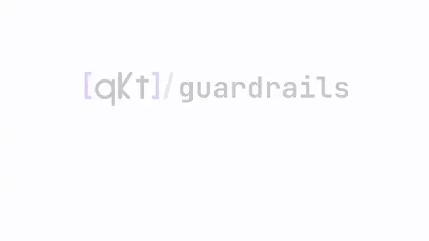

<p align="center">
  <picture>
    <source media="(prefers-color-scheme: dark)" srcset="docs/assets/qkt-guardrails-logo-dark.svg">
    
  </picture>
</p>

<h3 align="center">A second brake for your account.<br/>It watches equity and kills the book at your limits.</h3>

<p align="center">
  <a href="https://github.com/elitekaycy/qkt-guardrails/actions/workflows/ci.yml"></a>
  <a href="LICENSE"></a>
  <a href="https://github.com/elitekaycy/qkt-guardrails/pkgs/container/qkt-guardrails"></a>
</p>

<p align="center">
  <a href="docs/assets/qkt-guardrails-full-dark.mp4">
    <picture>
      <source media="(prefers-color-scheme: dark)" srcset="docs/assets/qkt-guardrails-loop-dark.webp">
      
    </picture>
  </a>
</p>

<p align="center"><sub>Every command in this clip was run for real, against a stand-in gateway.<br/><a href="docs/assets/qkt-guardrails-full-dark.mp4">Watch the full walkthrough</a></sub></p>

<br/>

## What it is

A small, independent process that polls your account's floating equity and enforces loss limits
through the broker gateway's kill switch. Your engine has risk limits too, but they live inside
the process being guarded: if it hangs, they hang with it. The guardian knows nothing about your
engine and speaks only to the gateway, so it can still flatten when everything else has failed.

```text
your engine ──▶ mt5-gateway ──▶ MT5 ──▶ broker
                  ▲   ▲
       kill/flatten   equity poll
              └─ guardian (one per account) ─┘
```

It works for [qkt](https://github.com/elitekaycy/qkt) and for any strategy behind an
[mt5-gateway](https://github.com/elitekaycy/mt5-gateway). Python 3.12, standard library only.

> [!WARNING]
> It flattens real positions. Drill every rung on a demo account before it guards money.

<br/>

## Quick start

This runs the guardian against a stand-in gateway, so you need no broker. Run it from a clone
of this repo.

**1. Write the limits**

```bash
mkdir -p configs
cp examples/demo.yaml configs/demo.yaml
cat >> configs/demo.yaml <<'EOF'
ladder:
  soft_pct: 2.5
  hard_pct: 3.5
  friday_flat: false
  news_feed: http://127.0.0.1:5811/calendar
EOF
```

**2. Start the stand-in gateway and the guardian**

```bash
echo 50000 > configs/equity.txt
python3 examples/fake-gateway.py configs/equity.txt \
  > configs/gateway.log 2>&1 &
python3 -m guardian --config configs/demo.yaml \
  > configs/guardian.log 2>&1 &
sleep 2 && cat configs/guardian.log
```

You will see `guardian[demo] v… up: initial=50000.0 soft=2.5% hard=3.5% …`. That is the guardian
watching.

**3. Drop the account's equity**

```bash
echo 48600 > configs/equity.txt     # down 2.8%
sleep 2 && grep KILL configs/guardian.log

echo 48000 > configs/equity.txt     # down 4%
sleep 2 && grep -m1 HARD configs/guardian.log
```

`KILL engaged (DAILY-SOFT)` means new orders are blocked. `flatten re-issued (DAILY-HARD)` means
it asked the gateway to close everything.

**4. See what it sent, then clean up**

```bash
uniq configs/gateway.log
pkill -f 'examples/[f]ake-gateway.py'; pkill -f 'guardian --config configs/[d]emo'
```

The log shows `POST /kill` and `POST /kill?flatten=true`: the calls a real gateway would receive.
For a real account, start from a preset in [`examples/`](examples) and see
[Configuration](docs/configuration.md).

<br/>

## Next

| I want to | Read |
| --- | --- |
| Understand SOFT, HARD, STATIC, NEWS and WEEKEND | [The ladder](docs/ladder.md) |
| Set up an account, Docker, news sources | [Configuration](docs/configuration.md) |
| Prove each rung fires before trusting it | [Drill playbook](drills/PLAYBOOK.md) |
| Avoid the known mistakes | [Dos and don'ts](docs/DOS-AND-DONTS.md) |
| Cut a release | [Releasing](docs/RELEASING.md) · [Changelog](CHANGELOG.md) |
| Build, test, contribute | [Development](docs/development.md) |

<br/>

<sub>Apache 2.0 licensed. Sibling of [qkt](https://github.com/elitekaycy/qkt), [qkt-insights](https://github.com/elitekaycy/qkt-insights) and [mt5-gateway](https://github.com/elitekaycy/mt5-gateway).</sub>
